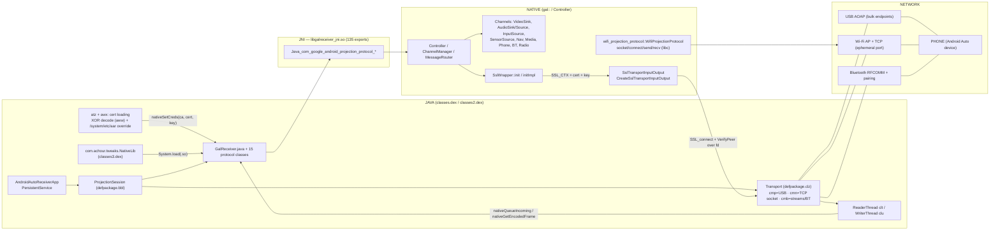

# AutoLinker — Architecture Map: Java → JNI → Native → Network → Authentication

APK: `com.google.android.embedded.projection` v1.0.413336740-release · SHA-256 `18b6d3ab…4603e3`
All links below were verified in the decompiled output (jadx Java + Ghidra C), not inferred from names.
Full machine-readable table: `jni_map.csv` (all 135 JNI exports, Java class/method, native address).

---

## 1. The whole flow in one diagram



**Key structural fact:** Java is a *dumb pipe*. It moves raw bytes between the physical
transport and the native library. All framing, channel multiplexing, protobuf messages
and TLS live in native code. The only things Java decides are: which transport, and
which certificates to hand down.

---

## 2. Java layer

### Entry points (AndroidManifest.xml)
- Application: `com.google.android.apps.auto.aareceiver.AndroidAutoReceiverApp`
- `service.PersistentService`, `service.EntrypointBroadcastReceiver`, `service.ProjectionCommandReceiver`
- UI: `AndroidAutoHeadunitActivity`, `WaitingForConnectionActivity`, `SslCertificateIssueActivity` ← exists specifically for TLS failures
- USB: `transport.usb.NewDeviceActivity`, `transport.usb.AoapSupportCheckService`

### Session core
- `defpackage.bbl` = **ProjectionSession**. Its constructor builds the `GalReceiver`:
  ```java
  GalReceiver galReceiver = new GalReceiver(..., carInfo,
      awx.a(rootCertAsset),            // CA cert (PEM string)
      awx.b("c1", certificateAsset),   // client cert — overridable, see §5
      awx.b("p1", keyAsset),           // private key — overridable, see §5
      null, null);
  ```
- `defpackage.clv / clo` = transport session holder; `clt` = **ReaderThread**, `clu` = **WriterThread**.

### The pump (this is the Java↔Native data boundary)
```
ReaderThread (clt.a()):
    read 4-byte header from transport
    n = GalReceiver.nativeGetAdditionalBytesToRead(header)
    read n more bytes
    GalReceiver.nativeQueueIncoming(frame, n + 4)

WriterThread (clu.a()):
    n = GalReceiver.nativeGetEncodedFrame(buf)
    transport.write(buf, n)        // up to 10 retries
```
Frames are opaque to Java — already encrypted/encoded by native before Java sees them on write,
and still encoded when handed to native on read.

### Protocol classes (Java side of JNI)
`GalReceiver` (21 exports), `SensorSource` (28), `RadioEndpoint` (16), `InputSource` (13),
`VideoSink` (11), `AudioSink` (9), `BluetoothEndpoint` (7), `AudioSource` (4), `MediaBrowser` (4),
`GalVerificationVendorExtension` (4), `WirelessProjectionProtocol` (4), `MediaPlaybackStatus` (3),
`NavigationStatus` (3), `PhoneStatus` (3), `VendorExtensionBase` (3), `WifiProjectionEndpoint` (2).

### The tweak's entry point (classes3.dex)
`GalReceiver`'s static block was patched: original `System.loadLibrary` →
**`com.achour.tweaks.NativeLib.load()`**, which tries, in order:
1. `applicationInfo.nativeLibraryDir/libgalreceiver_jni.so` (installer-extracted)
2. Extract the `.so` from the APK zip itself into `files/nativelib/` and `System.load()` it
3. `System.loadLibrary("galreceiver_jni")`
4. Hard-coded `/system/lib64`, `/system/lib`, `/vendor/lib64`, `/vendor/lib` paths

---

## 3. JNI layer

- 135 exports, all `Java_com_google_android_projection_protocol_*`, addresses 0x60a02c–0x618xxx
  in `libgalreceiver_jni.so` (full list + addresses in `jni_map.csv`).
- JNI functions are **thin wrappers**: they read the native peer pointer from the Java field
  `mNativeGalReceiver` / `mNative<Endpoint>` and dispatch into a C++ object. Example (verified):
  ```
  GalReceiver_nativeSetCreds (0x60d5c4)
      → JNIEnv GetStringUTFChars ×3
      → GetObjectField(fidNativeGalReceiver)
      → Controller::setClientCreds (0x61fa94)   [on the object at +0x19a0]
  ```
- **Reverse direction (Native → Java)** is just as important: native calls back through
  `JNIEnv` vtable offsets into the `*Callbacks` interfaces — `ControllerCallbacks`
  (serviceDiscoveryRequest, byeBye, battery, audio/nav focus…), `VideoSinkCallbacks`,
  `AudioSinkCallbacks`, `SensorSourceCallbacks`, `WifiProjectionCallbacks`
  (`onWifiCredentialsRequest`), `ConnectionConfigurationCallbacks` (TCP buffer/timeout tuning).
- **Dead exports:** `RadioEndpoint`, `MediaBrowser`, `PhoneStatus`, `GalVerificationVendorExtension`
  and `WirelessProjectionProtocol` have JNI exports in the `.so` but **no corresponding Java
  endpoint class exists in this APK's 3 dex files** (only their `*Callbacks` interfaces are present).
  In this build those native entry points are unreachable from Java — the `.so` is shared across variants.

---

## 4. Native layer (gal::)

- `Controller` — session brain: owns `ChannelManager` + `MessageRouter`, holds creds
  (`setClientCreds`), car/head-unit info (`nativeSetCarInfo`, `nativeSetHeadUnitInfo`,
  `nativeSetIdentityInfo`), transport-config listener.
- One C++ endpoint object per Java protocol class (AudioSinkCallbacks, VideoSink, InputSource,
  SensorSource, RadioEndpoint, BluetoothEndpoint, WifiProjectionEndpoint…), each registered
  into the Controller via its `nativeInit(channelId, nativePeer)` → `nativeRegister`.
- `JniTransportInputOutput` — native's view of the Java transport (calls back into `clz`).
- `Transport` / `SslTransportFactory` — wraps the raw transport in TLS when required (Wi-Fi).
- `wifi_projection_protocol::WifiProjectionProtocol` — a **separate native protocol stack**
  for wireless discovery/connection (`get`, `onConnect`, `onDisconnect`, `startProjection`,
  internal `ReadLoop`, own `socket()/connect()/send()/recv()/poll()` libc calls),
  plus `gal::WifiProjectionService` protobuf messages (`WifiCredentialsRequest`,
  `WifiSecurityMode`, …). It asks Java for the car AP credentials through
  `WifiProjectionEndpoint.nativeInit(id, peer, carWifiBSSID)` →
  callback `onWifiCredentialsRequest()` → Java returns SSID/password/security mode/channels
  from the car's Wi-Fi configuration (`CarWifi$CarWifiCredentials`).

---

## 5. Network layer

| Transport | Java side | Native side | Notes |
|---|---|---|---|
| **USB (AOAP)** | `defpackage.cmp` — `UsbManager.openDevice`, bulk IN/OUT endpoints; `NewDeviceActivity`, `AoapSupportCheckService` | none (raw pipe) | Wired Android Auto. Bytes go straight into the Reader/Writer pump. |
| **Wi-Fi** | `AccessPoint` (`defpackage.bdq`) starts car AP via `CarCompat.startProjectionAccessPoint`; `WirelessSocketProvider` (`bdu`) = `new ServerSocket(0)` → **ephemeral TCP port**; `cmn` wraps the accepted `Socket` | `WifiProjectionProtocol` (discovery + connect), `SslTransportInputOutput` (TLS over the socket fd) | Only transport that adds TLS on top of the GAL stream. |
| **Bluetooth** | `RfcommServer` (`avx/avv/avu`) — `BluetoothServerSocket`/`BluetoothSocket`; `BluetoothEndpoint.nativeSendAuthData(String, int)`, `nativeRequestDelayedPairing`, `nativeOnReadyForPairing` | `BluetoothEndpoint` C++ object | BT is for discovery/pairing + auth data exchange; projection itself runs over Wi-Fi/USB. |
| **Generic streams** | `defpackage.cmb` — plain `InputStream/OutputStream` pair | `JniTransportInputOutput` | Base implementation the others reuse. |

Native libc imports used for networking: `socket, connect, send, recv, poll, read, write, fcntl`
— all inside the Wi-Fi projection stack and the SSL transport; USB/BT sockets are owned by Java.

---

## 6. Authentication layer

### 6.1 Certificate chain — end to end (all steps verified)
```
assets/credentials/ca.pem        (root_certificate)
assets/credentials/client.pem    (certificate)
assets/credentials/private.key   (key)
        │  atz.java: name → asset path map
        ▼
awx.a() / awx.b()  read the files
        │  every read passes through aww: XOR with the package name
        │  "com.google.android.embedded.projection" as repeating key
        │  → the PEM/key files in the APK are XOR-obfuscated, decoded in memory only
        ▼
ProjectionSession (bbl) constructor
        ▼
GalReceiver.<init>: nativeInit() → nativeSetCreds(ca, cert, key)
        │  failure → RuntimeException("SSL initialization failed")
        ▼
JNI nativeSetCreds (0x60d5c4) → Controller::setClientCreds (0x61fa94)
        ▼
SslWrapper::init(ca, cert, key) → initImpl(..., SslMode)
        GalUtil::ReadPemCertificate  → PEM_read_bio_X509        (×2: CA + client cert)
        GalUtil::ReadPrivateKey      → PEM_read_bio_PrivateKey
        SSL_CTX_new (BoringSSL)
        SSL_CTX_use_certificate / SSL_CTX_use_PrivateKey / SSL_check_private_key
        SSL_CTX_set_min_proto_version / SSL_CTX_set_options
        ▼
CreateSslTransportInputOutput (0x663354)
        SSL_new → SSL_set_fd(fd) → VerifyPeer → SSL_connect   (native acts as TLS client)
        VerifySslCallback (0x663840) → X509_STORE_CTX_get_error / get_ex_data
```

### 6.2 Cert override — the "GoogleCert" surface
`awx.b("c1", …)` / `awx.b("p1", …)` search external directories **before** falling back to the
bundled assets. The directory list (`atz.java` case 3) contains **`/system/etc/aar`** plus the
app's configured base path. So:
- a file named **`c1`** in `/system/etc/aar` replaces the client certificate,
- a file named **`p1`** replaces the private key,
- the **root CA has no override** — it is always read from the bundled `ca.pem` via `awx.a()`.

That asymmetry is the point: a replacement cert/key only works if it chains to Google's
bundled root CA, which is exactly what `VerifyPeer` enforces on the other side.

### 6.3 Other auth mechanisms
- **Bluetooth pairing auth:** `BluetoothEndpoint.nativeSendAuthData(String, int)` — Java
  (`defpackage.avf`) formats and sends auth data during pairing; native decides readiness
  (`nativeOnReadyForPairing`, `nativeRequestDelayedPairing`).
- **Wi-Fi AP credentials:** not stored in the APK — supplied at runtime by the car
  (Java callback `onWifiCredentialsRequest`, §4) and consumed by the native Wi-Fi stack.
- **Identity info:** `GalReceiver.nativeSetIdentityInfo` / `nativeSetHeadUnitInfo` exports
  exist natively; identity exchange happens inside the GAL service-discovery handshake
  (`ControllerCallbacks.serviceDiscoveryRequestCallback`).
- **GalVerificationVendorExtension** (native-only in this build, §3): a vendor channel
  (`nativeInit/nativeSend/nativeCloseChannel`) reserved for device verification messages.
- **Failure surface in UI:** `SslCertificateIssueActivity` is shown on cert/TLS errors —
  the user-visible end of the chain in §6.1.

### 6.4 Security notes
- The bundled `private.key` is protected only by the XOR obfuscation above (key = package
  name, public knowledge). Anyone with the APK can recover the plain PEM in seconds.
  **Do not share the decompiled package publicly.**
- TLS verification is real (BoringSSL, `VerifyPeer` + verify callback, min protocol version
  set in `SslWrapper::initImpl`) — the weak point is key distribution, not the handshake.

---

## 7. Where to look for what

| Question | Start here |
|---|---|
| How does a session start/stop? | Java `defpackage.bbl` → `GalReceiver.nativeStart/nativeShutdown` → `Controller` |
| How do bytes move? | Java `clt/clu/clv/clz` → `nativeQueueIncoming/nativeGetEncodedFrame` → `ChannelManager/MessageRouter` |
| How does TLS get its certs? | §6.1 chain: `atz` → `awx/aww` → `nativeSetCreds` → `Controller::setClientCreds` → `SslWrapper::initImpl` |
| How does wireless connect? | Java `bdq (AccessPoint)`, `bdu (WirelessSocketProvider)` → native `wifi_projection_protocol::WifiProjectionProtocol` |
| How does pairing/auth work? | Java `avf/avx` + `BluetoothEndpoint` natives; §6.3 |
| What did the tweak change? | `com.achour.tweaks.NativeLib` loader (patched `GalReceiver` static block) + cert-override path in §6.2 |
| Any function address | `jni_map.csv` (JNI) or `native/ghidra_c/INDEX.txt` (all 45,641 native functions) |
